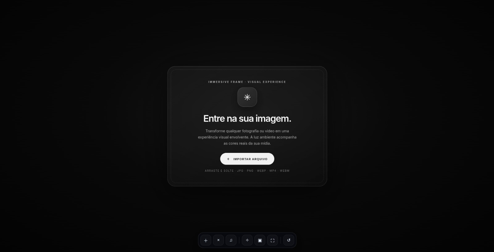

# Immersive Frame



Transforme fotografias e vídeos em uma experiência visual para tela cheia. O **Immersive Frame** cria uma atmosfera de luz ambiente a partir das cores da própria mídia, mantendo o conteúdo principal em destaque.

## Visão geral

O projeto é uma experiência visual executada diretamente no navegador. Importe uma imagem ou vídeo, ajuste a atmosfera e personalize a apresentação sem precisar enviar seus arquivos para um servidor.

## Recursos

- **Imagens e vídeos:** suporte a JPG, PNG, WEBP, MP4 e WEBM.
- **Luz ambiente:** campo de cores gerado a partir da mídia exibida.
- **Ajustes visuais:** controles de intensidade, desfoque e tom do ambiente.
- **Atmosferas:** presets visuais para explorar diferentes combinações de cor.
- **Efeitos opcionais:** partículas, Living Image, parallax, filamentos laterais e realce de imagem.
- **Áudio:** reprodução de vídeo com controle de volume e opção de reação ao som.
- **Enquadramento:** alternância entre imagem ajustada à tela e preenchimento.
- **Tela cheia:** experiência sem distrações, com controles que aparecem durante a interação.
- **Privacidade local:** os arquivos são carregados no próprio navegador por meio de URLs temporárias; não há envio para um backend.

## Tecnologias

- HTML5 para a estrutura da aplicação.
- CSS3 para layout, animações, camadas visuais e adaptação a diferentes telas.
- JavaScript nativo para importação de mídia, controles e ciclo de animação.
- Canvas 2D para partículas e geração do campo de luz ambiente.
- Web Audio API para análise de áudio dos vídeos.
- APIs nativas do navegador para tela cheia e gerenciamento de arquivos locais.

O projeto é estático e não utiliza framework, servidor de aplicação ou banco de dados.

## Executar localmente

Requisitos: um navegador moderno. Para servir o projeto localmente, também é possível usar Python 3.

```bash
# Dentro da pasta ImmersiveFrame
python3 -m http.server 4173
```

Abra `http://localhost:4173` no navegador. Também é possível abrir `index.html` diretamente, mas utilizar um servidor local oferece um ambiente mais próximo da publicação web.

## Estrutura do projeto

```text
ImmersiveFrame/
├── index.html          # aplicação completa
├── images/
│   └── immersive.jpg   # imagem de apresentação do projeto
├── docs/               # documentação complementar
└── README.md           # apresentação e instruções do projeto
```

## Como usar

1. Abra a aplicação no navegador.
2. Importe uma imagem ou vídeo ou arraste o arquivo para a tela inicial.
3. Abra o painel de ajustes para controlar a atmosfera e ativar os efeitos desejados.
4. Use os controles de enquadramento e tela cheia para adaptar a experiência.
5. Para trocar de mídia ou voltar à tela inicial, utilize o botão de limpar.

## Privacidade e funcionamento

A mídia selecionada é processada localmente no navegador. O projeto não possui backend, autenticação ou armazenamento remoto. Ao limpar a tela ou substituir o arquivo, a URL temporária criada para a mídia anterior é liberada.

## Status

Projeto experimental em evolução. A experiência e os efeitos podem variar conforme o navegador, o dispositivo e o formato da mídia utilizada.
